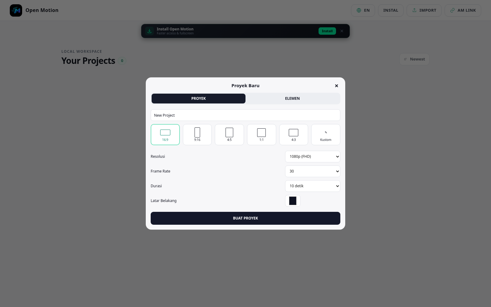

<div align="center">


<br>
<br>

<h1>Open Motion</h1>

<p><strong>Browser-native motion graphics and video timeline editor.</strong></p>

<p>
Keyframe timeline &nbsp;·&nbsp; 3D-aware compositor &nbsp;·&nbsp; WebAssembly camera tracker<br>
Stackable effects rack &nbsp;·&nbsp; Groups and workspaces &nbsp;·&nbsp; Fully client-side export
</p>

<p>
  <a href="https://ikyletwar.github.io/open-motion/"></a>
  
  
  
  
  
</p>

<p>
  <a href="https://ikyletwar.github.io/open-motion/"><kbd>&nbsp;Launch Application&nbsp;</kbd></a>
  &nbsp;
  <a href="https://github.com/Ikyletwar/open-motion"><kbd>&nbsp;Source Code&nbsp;</kbd></a>
  &nbsp;
  <a href="https://github.com/Ikyletwar/open-motion/issues"><kbd>&nbsp;Report an Issue&nbsp;</kbd></a>
</p>

</div>

---

> **Open Motion** is a self-contained, client-side motion graphics workspace that runs entirely in the browser. It combines a keyframe-driven timeline, a 3D-aware scene compositor, an effects rack, an embedded WebAssembly camera tracker, and a full export pipeline into one static web application. No backend. No build step. No server-side rendering.
>
> This repository is the **modular distribution** of the original single-file build. The former monolithic `index.html`, which inlined 65 stylesheets and 17 scripts, has been split into ordered, individually maintainable CSS and JavaScript modules while preserving the original cascade and execution order one-to-one.

---

<table>
  <tr>
    <td align="center" width="25%"><h3>67</h3><sub>CSS modules</sub></td>
    <td align="center" width="25%"><h3>18</h3><sub>JS modules</sub></td>
    <td align="center" width="25%"><h3>0</h3><sub>Build steps</sub></td>
    <td align="center" width="25%"><h3>100%</h3><sub>Client-side</sub></td>
  </tr>
</table>

---

## Navigation

<table>
  <tr>
    <td width="33%">
      <strong>Product</strong><br>
      <a href="#overview">Overview</a><br>
      <a href="#feature-set">Feature Set</a><br>
      <a href="#screenshots">Screenshots</a><br>
      <a href="#technology-stack">Technology Stack</a>
    </td>
    <td width="33%">
      <strong>Engineering</strong><br>
      <a href="#repository-layout">Repository Layout</a><br>
      <a href="#architecture-and-load-order">Architecture and Load Order</a><br>
      <a href="#embedded-asset-strategy">Embedded Asset Strategy</a><br>
      <a href="#css-module-catalog">CSS Module Catalog</a><br>
      <a href="#javascript-module-catalog">JavaScript Module Catalog</a>
    </td>
    <td width="33%">
      <strong>Operations</strong><br>
      <a href="#getting-started">Getting Started</a><br>
      <a href="#deployment">Deployment</a><br>
      <a href="#maintenance-contract">Maintenance Contract</a><br>
      <a href="#browser-support">Browser Support</a><br>
      <a href="#performance-notes">Performance Notes</a>
    </td>
  </tr>
</table>

---

## Overview

Open Motion targets a specific and demanding workflow: compositing and animating layered media on a timeline, with a visual preview that understands depth, camera motion, and per-layer transforms. It is built to feel like a desktop motion tool while remaining a single web surface that loads instantly and runs offline once cached.

The modular distribution retains three deliberate design constraints from the original build:

| Constraint | Description |
|---|---|
| **Zero build step** | There is no bundler, transpiler, or package manager in the critical path. The browser loads the modules directly. |
| **Strict load ordering** | Stylesheets cascade in a fixed numeric order, and scripts execute synchronously in a fixed numeric order. Both orders are load-bearing. |
| **Self-containment** | Runtime data, including image resources, the camera-track WebAssembly module, and license text, stays embedded in `index.html` as typed script blocks, so there are no fragile external asset dependencies. |

---

## Feature Set

Derived from the shipped modules and the editor surface exposed by the application.

| Domain | Capabilities |
|---|---|
| **Timeline and keyframes** | Scrubbable transport, marker system, per-layer keyframe channels, multi-layer arrangement |
| **Scene compositing** | Layered preview with X/Y/Z transforms, rotation, depth, borders, shadows, mattes, and track-matte sources |
| **3D camera tracking** | Embedded WebAssembly tracker with a per-glyph scene projection path, exposed through the tracking panel and tabs |
| **Effects rack** | Stackable effect system with a dedicated rack UI, spectrum presets, and shape-studio parity controls |
| **Groups and workspaces** | Layer grouping, group workspace isolation, and visibility state management |
| **Export pipeline** | Export result preview, export progress overlay, and selected-layer export with reduced-resolution preview |
| **Expressions and text** | Expression editing tiers and text preset styling |
| **Responsive and mobile** | Portrait control layout, mobile landscape desktop mode, mobile device overhaul, dedicated compatibility layer |
| **Keyboard-first control** | Documented shortcut layer |
| **PWA install surface** | Manifest and install prompt wiring |
| **Theme control** | Light and dark mode toggle with saved preference and system-preference fallback |
| **About** | Built-in About modal with the project philosophy, intended audience, and creator profile |
| **Diagnostics** | Audio diagnostics, preview diagnostics, and timeline diagnostics |
| **Usability and recovery** | Home recovery and health checks, element labels, responsive content adjustments |

---

## Screenshots

<p align="center"><strong>Editor</strong></p>

<div align="center">
  
</div>

<br>

<table>
  <tr>
    <td width="50%" align="center">
      <strong>Home workspace</strong><br><br>
      
    </td>
    <td width="50%" align="center">
      <strong>New project</strong><br><br>
      
    </td>
  </tr>
</table>

---

## Technology Stack

<table>
  <tr>
    <td width="50%" valign="top">
      <strong>Core</strong>
      <ul>
        <li>HTML5 with semantic sections and typed inline data blocks</li>
        <li>Hand-authored CSS3 with custom properties and media queries</li>
        <li>Vanilla JavaScript, ES2020+, classic synchronous scripts</li>
      </ul>
    </td>
    <td width="50%" valign="top">
      <strong>Compute and Delivery</strong>
      <ul>
        <li>WebAssembly camera tracker</li>
        <li>WebCodecs shim for legacy Android</li>
        <li>DOM, SVG, and canvas rendering</li>
        <li>Static hosting through GitHub Pages</li>
      </ul>
    </td>
  </tr>
</table>

No frameworks. No runtime dependency graph. No package lockfile.

---

## Repository Layout

```
open-motion/
├── index.html            Markup and typed data blocks only
├── css/                  67 ordered stylesheet modules
├── js/                   18 ordered script modules
├── docs/
│   └── screenshots/      Product screenshots used in this README
├── README.md             This document
├── manifest.webmanifest  PWA manifest (referenced; add if absent)
└── icons/                PWA and favicon assets (referenced; add if absent)
```

`index.html` no longer contains `<style>` blocks and no longer contains executable inline JavaScript, with one intentional exception described in [Embedded Asset Strategy](#embedded-asset-strategy).

---

## Architecture and Load Order

Open Motion is a classic, parse-blocking, synchronous application. Three ordering rules are sufficient to reason about almost every maintenance task.

```
Document parse
   │
   ├─ <head>
   │    └─ 67 <link rel="stylesheet"> in numeric order
   │         (01-base sets tokens; the rest refine and override)
   │
   ├─ <body> markup
   │    └─ typed data <script> blocks (inert, read via textContent)
   │
   └─ executable <script src> in numeric order
        ├─ 01 viewport bootstrap
        ├─ 02 splash
        ├─ 03 experimental notice
        ├─ 04 application core
        └─ 05 .. 18 feature patches (each depends on core globals and DOM)
```

| Rule | Meaning |
|---|---|
| **Rule 1 — Cascade is order** | Stylesheet `N+1` may override stylesheet `N`. Renumbering or reordering links changes the rendered result. |
| **Rule 2 — Execution is order** | Feature patches read globals and DOM established by earlier scripts. They must run after `04-app-main.js`. |
| **Rule 3 — Core is a closure** | `04-app-main.js` exposes a small number of `window` bridges and keeps the rest internal. Feature patches integrate through the DOM and those bridges. |

---

## Embedded Asset Strategy

A small number of typed script blocks remain inline in `index.html`. This is deliberate: the application reads their `.textContent` directly, so externalizing them would break the readers.

| Element | Type | Purpose |
|---|---|---|
| `#oms-res252-0` .. `#oms-res252-5` | `text/plain` | Base64 data-URI image resources |
| `#oms-camera-track-wasm` | `application/octet-stream` | Base64 WebAssembly camera tracker, decoded by `decodeWasm()` |
| `#oms-camera-track-licenses` | `text/plain` | Camera tracker license text |
| inline block in `#experimentalNotice` | classic | Uses `document.currentScript.parentElement`, so it must stay inline |

Do not move these into files unless you also update the code that reads them.

---

## CSS Module Catalog

The stylesheets are numbered `01` through `67`. The numeric prefix is the authoritative cascade order: later files intentionally override earlier ones. Each file is named after the feature or revision tag it originated from.

<details open>
<summary><strong>Foundation</strong></summary>

| File | Responsibility |
|---|---|
| `01-base.css` | Design tokens, reset, typography, home screen, shell layout |
| `02-oms-v429-layer-actions.css` | Layer action controls |
| `03-oms-editor-split-v393.css` | Editor split layout |
| `04-oms-portrait-side-controls-v397.css` | Portrait orientation side controls |
| `05-oms-collapsible-editor-top-v400.css` | Collapsible editor top bar |
| `06-oms-collapsible-editor-top-v401-fix.css` | Collapsible top bar correction |
| `07-oms-collapsible-editor-top-v402-dedicated-restore.css` | Dedicated restore control for collapsed top bar |
| `08-oms-v403-compact-top-controls-badge-reset-plus.css` | Compact top controls, badge, reset |

</details>

<details>
<summary><strong>Export</strong></summary>

| File | Responsibility |
|---|---|
| `09-omsexportresultpreviewstyles.css` | Export result preview |
| `10-omsexportprogressoverlaystyles.css` | Export progress overlay |

</details>

<details>
<summary><strong>Effects and Compositing</strong></summary>

| File | Responsibility |
|---|---|
| `11-oms-editor-ambient-v540.css` | Editor ambient styling |
| `12-oms-v586-vector-mobile-override.css` | Vector mobile overrides |
| `13-oms-effects-stack-v5124.css` | Effects stack |
| `14-oms-v5135-particular-ui.css` | Particle-style effect UI |
| `15-oms-v5161-shape-studio-parity.css` | Shape studio parity controls |
| `21-oms-effects-rack-v239.css` | Effects rack |
| `22-oms-spectrum-presets-v246.css` | Spectrum presets |
| `23-oms-border-shadow-v247.css` | Border and shadow controls |

</details>

<details>
<summary><strong>Tracking</strong></summary>

| File | Responsibility |
|---|---|
| `16-template-editor.css` | Template editor surface |
| `17-track-panel.css` | Tracking panel |
| `18-tracking-tabs.css` | Tracking tabs and motion key fields |
| `19-oms-point-filters-v238.css` | Track point filters and quality legend |

</details>

<details>
<summary><strong>Layers and Groups</strong></summary>

| File | Responsibility |
|---|---|
| `24-oms-groups-v248.css` | Layer groups |
| `25-oms-group-workspace-v249.css` | Group workspace |
| `49-oms-v448-layer-visibility-eye.css` | Layer visibility toggle |
| `50-oms-v449-selected-layer-export.css` | Selected layer export |
| `51-oms-v454-multi-layer-arrange.css` | Multi-layer arrangement |
| `59-oms-layer-header-v250.css` | Layer header |

</details>

<details>
<summary><strong>Home and Chrome</strong></summary>

| File | Responsibility |
|---|---|
| `20-oms-home-thumbnails-pr32.css` | Project thumbnails |
| `28-app-splash-screen-style.css` | Splash screen |
| `29-am-desktop-language-splitter-patch.css` | Desktop language splitter patch |
| `30-am-permanent-hide-old-split-handles.css` | Legacy split handle suppression |
| `31-am-desktop-home-scale-patch.css` | Desktop home scaling patch |
| `32-omscreditsstyle20261026.css` | Credits dialog |
| `58-am-parity-nav-and-action-menu-css.css` | Navigation and action menu |

</details>

<details>
<summary><strong>Input and Preferences</strong></summary>

| File | Responsibility |
|---|---|
| `26-oms-keyboard-shortcuts.css` | Keyboard shortcut surface |
| `33-oms-audio-diagnostics-v207.css` | Audio diagnostics |
| `34-oms-preview-diagnostics-v205.css` | Preview diagnostics |
| `52-oms-am-timeline-v197.css` | Timeline |
| `53-oms-diagnostics-v198.css` | Timeline diagnostics |

</details>

<details>
<summary><strong>Desktop Layout Revisions</strong></summary>

| File | Responsibility |
|---|---|
| `35-oms-v404-centered-restore-plus.css` | Centered restore control |
| `36-oms-v411-selected-layer-focus.css` | Selected layer focus |
| `37-oms-v430-mobile-landscape-desktop.css` | Mobile landscape desktop mode |
| `38-oms-v431-desktop-canvas-split-menu-fit.css` | Canvas split and menu fit |
| `39-oms-v432-desktop-toolbar-split-autofit.css` | Toolbar split autofit |
| `40-oms-v433-transport-center-split-fix.css` | Transport centering fix |
| `41-oms-v434-split-handle-3lines-fix.css` | Split handle icon fix |
| `42-oms-v442-horizontal-preview-min-content-fix.css` | Horizontal preview min-content fix |
| `43-oms-v444-desktop-add-drawer-bottom-dock.css` | Add drawer bottom dock |
| `44-oms-v445-desktop-bottom-drawers-compact-add-hub.css` | Compact bottom drawers and add hub |

</details>

<details>
<summary><strong>Transport</strong></summary>

| File | Responsibility |
|---|---|
| `45-oms-v435-play-anchored-transport.css` | Play-anchored transport |
| `46-oms-v436-right-dock-audio-layer-actions.css` | Right dock audio and layer actions |
| `47-oms-v435-svg-transport-icons.css` | SVG transport icons |
| `48-oms-v437-svg-play-center-fix.css` | SVG play center fix |

</details>

<details>
<summary><strong>Expression and Text</strong></summary>

| File | Responsibility |
|---|---|
| `54-omsexpressionstylev210.css` | Expression styling tier 210 |
| `55-omsexpressionstylev211.css` | Expression styling tier 211 |
| `56-omshighprioritystylev212.css` | High-priority styles |
| `57-omstextpresetstylev223.css` | Text presets |

</details>

<details>
<summary><strong>Final Overrides</strong></summary>

| File | Responsibility |
|---|---|
| `27-oms-mobile-device-overhaul.css` | Mobile device overhaul |
| `60-oms-mobile-compat-20261023.css` | Mobile compatibility |
| `61-oms-usability-20261023.css` | Usability refinements |
| `62-oms-responsive-content-20261023.css` | Responsive content |
| `63-oms-home-recovery-health-20261023.css` | Home recovery and health |
| `64-oms-element-labels-20261023.css` | Element labels |
| `65-oms-timeline-markers-20261030.css` | Timeline markers |
| `66-dark-theme.css` | Dark theme surfaces and toggle control |
| `67-oms-about.css` | About modal, creator profile and theme-aware surfaces |

</details>

---

## JavaScript Module Catalog

Scripts execute synchronously in numbered order. Do not reorder them and do not add `defer` or `async`.

| File | Responsibility |
|---|---|
| `01-oms-standalone-viewport-bootstrap.js` | Standalone and iOS viewport bootstrap |
| `02-app-splash-screen-script.js` | Splash screen lifecycle |
| `03-experimental-notice.js` | Experimental notice dialog behavior |
| `04-app-main.js` | Application core: state, timeline, compositing, effects, tracking, export, and UI wiring (single encapsulated IIFE) |
| `05-oms-v430-mobile-landscape-desktop-script.js` | Mobile landscape desktop mode |
| `06-oms-v431-desktop-canvas-split-menu-fit-script.js` | Canvas split and menu fit |
| `07-oms-v432-desktop-toolbar-split-autofit-script.js` | Toolbar split autofit |
| `08-oms-v433-transport-center-split-fix-script.js` | Transport centering fix |
| `09-oms-v435-play-anchored-transport-script.js` | Play-anchored transport |
| `10-oms-v436-right-dock-audio-layer-actions-script.js` | Right dock audio and layer actions |
| `11-oms-v437-svg-play-center-fix-script.js` | SVG play center fix |
| `12-oms-v533-pwa-install-script.js` | PWA install prompt |
| `13-oms-mobile-device-overhaul-script.js` | Mobile device overhaul |
| `14-am-parity-action-menu-script.js` | Action menu parity |
| `15-am-title-rename-script.js` | Project title rename |
| `16-oms-layer-header-v250-script.js` | Layer header behavior |
| `17-oms-theme-toggle.js` | Theme persistence, system preference and toggle wiring |
| `18-oms-about.js` | About modal open/close, Escape handling and trigger wiring |

> **Core module note.** `04-app-main.js` is intentionally kept as a single module. It is one large immediately-invoked function expression that encapsulates shared state. Splitting it further requires a deliberate refactor with explicit bridge objects, not a mechanical file cut.

---

## Getting Started

<table>
  <tr>
    <td width="50%" valign="top">
      <strong>Requirements</strong>
      <ul>
        <li>A modern browser</li>
        <li>Any static file server</li>
      </ul>
    </td>
    <td width="50%" valign="top">
      <strong>Run locally</strong>
      <pre><code>git clone https://github.com/Ikyletwar/open-motion.git
cd open-motion
python3 -m http.server 8000</code></pre>
    </td>
  </tr>
</table>

Open [http://localhost:8000/](http://localhost:8000/) in your browser.

Alternatively, with Node.js:

```bash
npx serve .
```

> Do not open `index.html` directly with the `file://` scheme. Some browsers restrict local module and asset loading under `file://`, and behavior will differ from the hosted deployment.

---

## Deployment

### GitHub Pages

The repository is served directly from the `main` branch root and is already published.

| Setting | Value |
|---|---|
| Source | Deploy from a branch |
| Branch | `main` |
| Folder | `/ (root)` |
| Published URL | https://ikyletwar.github.io/open-motion/ |

To re-publish from scratch: open `Settings` -> `Pages`, choose `Deploy from a branch`, select `main` and `/ (root)`, then save.

Because there is no build step, any push to `main` that changes `index.html`, `css/`, or `js/` is reflected on the next Pages build.

### Any static host

Upload the repository contents as-is. No server runtime is required. Correct MIME types for `.css`, `.js`, and `.webmanifest` are the only server-side consideration.

---

## Maintenance Contract

Follow these rules to keep the modular build equivalent to the original single-file application.

| Rule | Do | Do not |
|---|---|---|
| Ordering | Preserve numeric prefixes that encode cascade and execution order | Rename or reorder modules casually |
| Loading | Keep scripts synchronous | Add `defer` or `async` |
| Data blocks | Keep typed data scripts inline in `index.html` | Externalize `text/plain` or `octet-stream` blocks |
| New styles | Append `68-...css` and add a link after the last stylesheet | Edit an existing module for a new unrelated feature |
| New scripts | Append `19-...js` after the last script | Insert mid-sequence |
| Overrides | Keep "fix" modules separate; they intentionally win the cascade | Merge override modules into their base |

### Quick verification checklist

```text
[ ] Home screen visible (grid layout)
[ ] No console errors
[ ] Splash screen dismisses
[ ] All 67 stylesheets return 200
[ ] All 18 scripts return 200
```

---

## Browser Support

| Browser | Status |
|---|---|
| Chromium-based: Chrome, Edge, Brave, Opera | Supported |
| Firefox | Supported |
| Safari, desktop and iOS | Supported, with iOS viewport handling |
| Legacy Android Chromium, Android 6-8, Chromium 95 | Supported through the WebCodecs and performance shim in the core module |

WebAssembly and WebCodecs availability depend on the browser version; the core module includes shims and fallbacks where required.

---

## Performance Notes

- The repository is roughly 9.6 MB. `index.html` is about 3.8 MB because it embeds the application's runtime data resources.
- The core module `04-app-main.js` is large by design. It is fetched once and executes synchronously at load.
- Total stylesheet count is 67. On a cold load this is many requests; on a warm load, and on GitHub Pages, they are cached.
- GitHub Pages serves with HTTP/2 multiplexing, which mitigates the request count in practice.
- For a single-request production bundle, concatenate the CSS files in numeric order into one file and the scripts in numeric order into one file, then reference the bundles. This optimization is optional and not part of this distribution.

---

## Contributing

1. Read the [Maintenance Contract](#maintenance-contract).
2. Create a topic branch.
3. Make the smallest change that satisfies the requirement, respecting ordering rules.
4. Verify locally with the checklist above.
5. Open a pull request describing which module changed and why.

Bug reports should include the browser, the console output, and the module filename where the issue appears.

---

## Attribution and Licensing

Open Motion is an experimental prototype. The application identifies itself as an experimental preview and states that its feature set, playback, timeline, 3D system, performance, and editor features are under active development.

The embedded 3D camera tracker ships with its own license text, retained verbatim in `#oms-camera-track-licenses` inside `index.html`.

Third-party names referenced by the application, including Opus Framework, the Prismatic Company, and platform vendors, remain the property of their respective owners.

Unless a separate license file is added to this repository, treat the source as published for review and experimentation. Add a `LICENSE` file to declare explicit terms before redistribution.

---

<div align="center">

<sub>Repository metadata</sub>

| Field | Value |
|---|---|
| Name | open-motion |
| Type | Static web application |
| Primary language | JavaScript |
| Build system | None |
| Hosting | GitHub Pages, branch `main`, root |
| Entry point | `index.html` |
| Modular units | 67 CSS files, 18 JS files |

<br>

<strong>Open Motion</strong>
<br>
<sub>Layered motion, on a timeline, in the browser.</sub>

</div>
