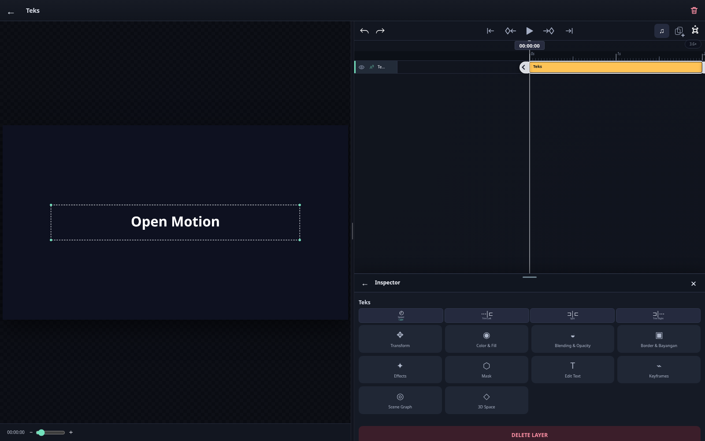
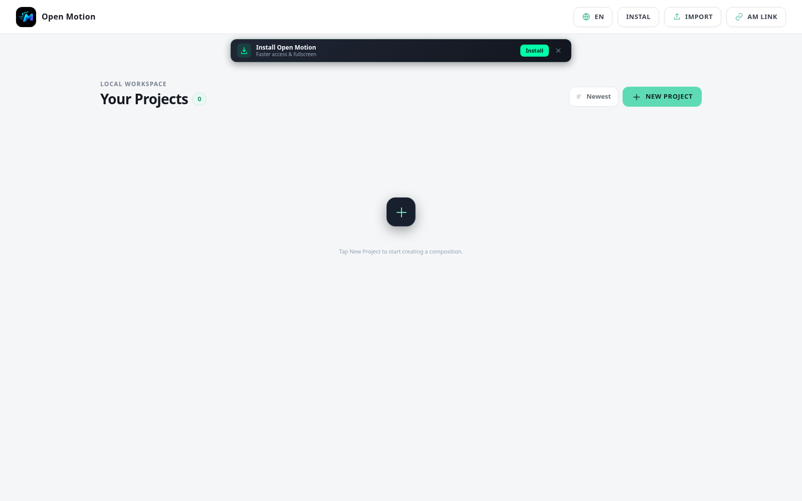

# Open Motion

### A modular, browser-native motion graphics and video timeline editor.

Open Motion is a self-contained, client-side motion graphics workspace that runs entirely in the browser. It combines a keyframe-driven timeline, a 3D-aware scene compositor, an effects rack, a camera tracker (WebAssembly), and a full export pipeline into a single static web application — no backend, no build step, no server-side rendering.

This repository is the **modular distribution** of the original single-file build. The former monolithic `index.html` (which inlined 65 stylesheets and 17 scripts) has been split into ordered, individually maintainable CSS and JavaScript modules while preserving the original execution and cascade order one-to-one.

[](https://ikyletwar.github.io/open-motion/)
[]()
[]()
[]()

---

## Screenshots

<div align="center">
  
</div>

<table>
  <tr>
    <td width="50%" align="center"><strong>Home workspace</strong><br><br></td>
    <td width="50%" align="center"><strong>New project</strong><br><br></td>
  </tr>
</table>

---

## Live Application

| Environment | URL |
|---|---|
| GitHub Pages | https://ikyletwar.github.io/open-motion/ |
| Source | https://github.com/Ikyletwar/open-motion |

The application is fully static. Every asset required at runtime is either embedded in the HTML (as typed data script blocks) or served as a local module from this repository.

---

## Table of Contents

1. [Overview](#overview)
2. [Feature Set](#feature-set)
3. [Technology Stack](#technology-stack)
4. [Repository Layout](#repository-layout)
5. [CSS Module Catalog](#css-module-catalog)
6. [JavaScript Module Catalog](#javascript-module-catalog)
7. [Architecture and Load Order](#architecture-and-load-order)
8. [Embedded Asset Strategy](#embedded-asset-strategy)
9. [Getting Started](#getting-started)
10. [Deployment](#deployment)
11. [Maintenance Contract](#maintenance-contract)
12. [Browser Support](#browser-support)
13. [Performance Notes](#performance-notes)
14. [Contributing](#contributing)
15. [Attribution and Licensing](#attribution-and-licensing)

---

## Overview

Open Motion targets a specific and demanding workflow: compositing and animating layered media on a timeline, with a visual preview that understands depth, camera motion, and per-layer transforms. It is built to feel like a desktop motion tool while remaining a single web surface that loads instantly and runs offline once cached.

The modular distribution retains three deliberate design constraints from the original build:

- **Zero build step.** There is no bundler, transpiler, or package manager in the critical path. The browser loads the modules directly.
- **Strict load ordering.** Stylesheets cascade in a fixed numeric order, and scripts execute synchronously in a fixed numeric order. Both orders are load-bearing.
- **Self-containment.** Runtime data (image resources, the camera-track WebAssembly module, license text) stays embedded in `index.html` as typed script blocks so the application has no fragile external asset dependencies.

---

## Feature Set

Derived from the shipped modules and the editor surface exposed by the application:

- **Timeline and keyframes** — a scrubbable transport, marker system, per-layer keyframe channels, and multi-layer arrangement.
- **Scene compositing** — layered preview with X/Y/Z transforms, rotation, depth, borders, shadows, mattes, and track-matte sources.
- **3D camera tracking** — an embedded WebAssembly tracker module with a per-glyph scene projection path, exposed through the tracking panel and tracking tabs.
- **Effects rack** — a stackable effect system with a dedicated rack UI, spectrum presets, and shape-studio parity controls.
- **Groups and workspaces** — layer grouping, group workspace isolation, and visibility/eye state management.
- **Export pipeline** — export result preview, export progress overlay, and selected-layer export with a reduced-resolution preview mode.
- **Expressions and text presets** — expression editing tiers plus text preset styling.
- **Responsive and mobile modes** — a portrait control layout, a mobile landscape desktop mode, a mobile device overhaul, and a dedicated mobile compatibility layer.
- **Keyboard-first control** — a documented shortcut layer.
- **PWA install surface** — manifest and install prompt wiring (see the asset note below).
- **Diagnostics** — audio diagnostics, preview diagnostics, and timeline diagnostics surfaces.
- **Usability and recovery** — home recovery/health checks, element labels, and responsive content adjustments.

---

## Technology Stack

| Layer | Technology |
|---|---|
| Markup | HTML5, semantic sections, typed inline data blocks |
| Styling | Hand-authored CSS3, custom properties, media queries, no preprocessor |
| Logic | Vanilla JavaScript (ES2020+), classic synchronous scripts |
| Compute | WebAssembly (camera tracker), WebCodecs shim for legacy Android |
| Rendering | DOM and SVG, canvas preview, CSS transforms |
| Delivery | Static hosting, GitHub Pages |

No frameworks. No runtime dependency graph. No package lockfile.

---

## Repository Layout

```
open-motion/
├── index.html            Markup and typed data blocks only
├── css/                  65 ordered stylesheet modules
├── js/                   16 ordered script modules
├── README.md             This document
├── manifest.webmanifest  PWA manifest (referenced; add if absent)
└── icons/                PWA and favicon assets (referenced; add if absent)
```

`index.html` no longer contains `<style>` blocks and no longer contains any executable inline JavaScript, with one intentional exception described in [Embedded Asset Strategy](#embedded-asset-strategy).

---

## CSS Module Catalog

The stylesheets are numbered `01` through `65`. The numeric prefix is the authoritative cascade order: later files intentionally override earlier ones. Each file is named after the feature or revision tag it originated from.

### Foundation

| File | Responsibility |
|---|---|
| `01-base.css` | Design tokens (color, spacing, radius, shadow), reset, typography, home screen, shell layout |
| `02-oms-v429-layer-actions.css` | Layer action controls |
| `03-oms-editor-split-v393.css` | Editor split layout |
| `04-oms-portrait-side-controls-v397.css` | Portrait orientation side controls |
| `05-oms-collapsible-editor-top-v400.css` | Collapsible editor top bar |
| `06-oms-collapsible-editor-top-v401-fix.css` | Collapsible top bar correction |
| `07-oms-collapsible-editor-top-v402-dedicated-restore.css` | Dedicated restore control for collapsed top bar |
| `08-oms-v403-compact-top-controls-badge-reset-plus.css` | Compact top controls, badge, reset |

### Export

| File | Responsibility |
|---|---|
| `09-omsexportresultpreviewstyles.css` | Export result preview |
| `10-omsexportprogressoverlaystyles.css` | Export progress overlay |

### Effects and Compositing

| File | Responsibility |
|---|---|
| `11-oms-editor-ambient-v540.css` | Editor ambient styling |
| `12-oms-v586-vector-mobile-override.css` | Vector mobile overrides |
| `13-oms-effects-stack-v5124.css` | Effects stack |
| `14-oms-v5135-particular-ui.css` | Particle-style effect UI |
| `15-oms-v5161-shape-studio-parity.css` | Shape studio parity controls |
| `21-oms-effects-rack-v239.css` | Effects rack |
| `22-oms-spectrum-presets-v246.css` | Spectrum presets |
| `23-oms-border-shadow-v247.css` | Border and shadow controls |

### Tracking

| File | Responsibility |
|---|---|
| `16-template-editor.css` | Template editor surface |
| `17-track-panel.css` | Tracking panel |
| `18-tracking-tabs.css` | Tracking tabs and motion key fields |
| `19-oms-point-filters-v238.css` | Track point filters and quality legend |

### Layers and Groups

| File | Responsibility |
|---|---|
| `24-oms-groups-v248.css` | Layer groups |
| `25-oms-group-workspace-v249.css` | Group workspace |
| `49-oms-v448-layer-visibility-eye.css` | Layer visibility toggle |
| `50-oms-v449-selected-layer-export.css` | Selected layer export |
| `51-oms-v454-multi-layer-arrange.css` | Multi-layer arrangement |
| `59-oms-layer-header-v250.css` | Layer header |

### Home and Chrome

| File | Responsibility |
|---|---|
| `20-oms-home-thumbnails-pr32.css` | Project thumbnails |
| `28-app-splash-screen-style.css` | Splash screen |
| `29-am-desktop-language-splitter-patch.css` | Desktop language splitter patch |
| `30-am-permanent-hide-old-split-handles.css` | Legacy split handle suppression |
| `31-am-desktop-home-scale-patch.css` | Desktop home scaling patch |
| `32-omscreditsstyle20261026.css` | Credits dialog |
| `58-am-parity-nav-and-action-menu-css.css` | Navigation and action menu |

### Input and Preferences

| File | Responsibility |
|---|---|
| `26-oms-keyboard-shortcuts.css` | Keyboard shortcut surface |
| `33-oms-audio-diagnostics-v207.css` | Audio diagnostics |
| `34-oms-preview-diagnostics-v205.css` | Preview diagnostics |
| `52-oms-am-timeline-v197.css` | Timeline |
| `53-oms-diagnostics-v198.css` | Timeline diagnostics |

### Desktop Layout Revisions

| File | Responsibility |
|---|---|
| `35-oms-v404-centered-restore-plus.css` | Centered restore control |
| `36-oms-v411-selected-layer-focus.css` | Selected layer focus |
| `37-oms-v430-mobile-landscape-desktop.css` | Mobile landscape desktop mode |
| `38-oms-v431-desktop-canvas-split-menu-fit.css` | Canvas split and menu fit |
| `39-oms-v432-desktop-toolbar-split-autofit.css` | Toolbar split autofit |
| `40-oms-v433-transport-center-split-fix.css` | Transport centering fix |
| `41-oms-v434-split-handle-3lines-fix.css` | Split handle icon fix |
| `42-oms-v442-horizontal-preview-min-content-fix.css` | Horizontal preview min-content fix |
| `43-oms-v444-desktop-add-drawer-bottom-dock.css` | Add drawer bottom dock |
| `44-oms-v445-desktop-bottom-drawers-compact-add-hub.css` | Compact bottom drawers and add hub |

### Transport

| File | Responsibility |
|---|---|
| `45-oms-v435-play-anchored-transport.css` | Play-anchored transport |
| `46-oms-v436-right-dock-audio-layer-actions.css` | Right dock audio and layer actions |
| `47-oms-v435-svg-transport-icons.css` | SVG transport icons |
| `48-oms-v437-svg-play-center-fix.css` | SVG play center fix |

### Expression and Text

| File | Responsibility |
|---|---|
| `54-omsexpressionstylev210.css` | Expression styling tier 210 |
| `55-omsexpressionstylev211.css` | Expression styling tier 211 |
| `56-omshighprioritystylev212.css` | High-priority styles |
| `57-omstextpresetstylev223.css` | Text presets |

### Final Overrides

| File | Responsibility |
|---|---|
| `27-oms-mobile-device-overhaul.css` | Mobile device overhaul |
| `60-oms-mobile-compat-20261023.css` | Mobile compatibility |
| `61-oms-usability-20261023.css` | Usability refinements |
| `62-oms-responsive-content-20261023.css` | Responsive content |
| `63-oms-home-recovery-health-20261023.css` | Home recovery and health |
| `64-oms-element-labels-20261023.css` | Element labels |
| `65-oms-timeline-markers-20261030.css` | Timeline markers |

---

## JavaScript Module Catalog

Scripts execute synchronously in numbered order. Do not reorder them and do not add `defer` or `async`.

| File | Responsibility |
|---|---|
| `01-oms-standalone-viewport-bootstrap.js` | Standalone and iOS viewport bootstrap |
| `02-app-splash-screen-script.js` | Splash screen lifecycle |
| `03-experimental-notice.js` | Experimental notice dialog behavior |
| `04-app-main.js` | Application core: state, timeline, compositing, effects, tracking, export, and UI wiring (single encapsulated IIFE) |
| `05-oms-v430-mobile-landscape-desktop-script.js` | Mobile landscape desktop mode |
| `06-oms-v431-desktop-canvas-split-menu-fit-script.js` | Canvas split and menu fit |
| `07-oms-v432-desktop-toolbar-split-autofit-script.js` | Toolbar split autofit |
| `08-oms-v433-transport-center-split-fix-script.js` | Transport centering fix |
| `09-oms-v435-play-anchored-transport-script.js` | Play-anchored transport |
| `10-oms-v436-right-dock-audio-layer-actions-script.js` | Right dock audio and layer actions |
| `11-oms-v437-svg-play-center-fix-script.js` | SVG play center fix |
| `12-oms-v533-pwa-install-script.js` | PWA install prompt |
| `13-oms-mobile-device-overhaul-script.js` | Mobile device overhaul |
| `14-am-parity-action-menu-script.js` | Action menu parity |
| `15-am-title-rename-script.js` | Project title rename |
| `16-oms-layer-header-v250-script.js` | Layer header behavior |

`04-app-main.js` is intentionally kept as a single module. It is one large immediately-invoked function expression that encapsulates shared state. Splitting it further requires a deliberate refactor with explicit bridge objects, not a mechanical file cut.

---

## Architecture and Load Order

Open Motion is a classic, parse-blocking, synchronous application. Understanding three ordering rules is sufficient to reason about almost every maintenance task.

```
Document parse
   │
   ├─ <head>
   │    └─ 65 <link rel="stylesheet"> in numeric order
   │         (01-base sets tokens; the rest refine and override)
   │
   ├─ <body> markup
   │    └─ typed data <script> blocks (inert, read via textContent)
   │
   └─ executable <script src> in numeric order
        ├─ 01 viewport bootstrap
        ├─ 02 splash
        ├─ 03 experimental notice
        ├─ 04 application core
        └─ 05..16 feature patches (each depends on core globals + DOM)
```

Rule 1 — Cascade is order. Stylesheet `N+1` may override stylesheet `N`. Renumbering or reordering links changes the rendered result.

Rule 2 — Execution is order. Feature patches read globals and DOM established by earlier scripts. They must run after `04-app-main.js`.

Rule 3 — Core is a closure. `04-app-main.js` exposes a small number of `window` bridges (for example the startup progress object) and keeps the rest internal. Feature patches integrate through the DOM and those bridges.

---

## Embedded Asset Strategy

A small number of typed script blocks remain inline in `index.html`. This is deliberate: the application reads their `.textContent` directly, so externalizing them would break the readers.

| Element | Type | Purpose |
|---|---|---|
| `#oms-res252-0` .. `#oms-res252-5` | `text/plain` | Base64 data-URI image resources |
| `#oms-camera-track-wasm` | `application/octet-stream` | Base64 WebAssembly camera tracker (decoded by `decodeWasm()`) |
| `#oms-camera-track-licenses` | `text/plain` | Camera tracker license text |
| inline block in `#experimentalNotice` | classic | Uses `document.currentScript.parentElement`, so it must stay inline |

Do not move these into files unless you also update the code that reads them.

---

## Getting Started

### Requirements

- A modern browser.
- Any static file server for local development.

### Run locally

```bash
git clone https://github.com/Ikyletwar/open-motion.git
cd open-motion
python3 -m http.server 8000
```

Open `http://localhost:8000/`.

Alternatively, with Node.js:

```bash
npx serve .
```

Do not open `index.html` directly with the `file://` scheme. Some browsers restrict local module and asset loading under `file://`, and behavior will differ from the hosted deployment.

---

## Deployment

### GitHub Pages (current)

The repository is served directly from the `main` branch root.

1. Go to `Settings` -> `Pages`.
2. Source: `Deploy from a branch`.
3. Branch: `main`, folder: `/ (root)`.
4. Save. The site publishes at `https://ikyletwar.github.io/open-motion/`.

Because there is no build step, any push to `main` that changes `index.html`, `css/`, or `js/` is immediately reflected on the next Pages build.

### Any static host

Upload the repository contents as-is. No server runtime is required. Correct MIME types for `.css`, `.js`, and `.webmanifest` are the only server-side consideration.

---

## Maintenance Contract

Follow these rules to keep the modular build equivalent to the original single-file application.

1. Preserve numeric ordering. Files are named with an ordinal prefix that encodes both cascade and execution order.
2. Preserve synchronous loading. Do not add `defer` or `async` to any `<script src>`.
3. Keep typed data blocks inline. See [Embedded Asset Strategy](#embedded-asset-strategy).
4. Add new styles as the next ordinal. Append `66-...css` and add one `<link>` after the last stylesheet rather than editing an existing module.
5. Add new patches as the next ordinal script. Append `17-...js` after the last script.
6. Do not merge override modules into their base. Several "fix" modules exist specifically to win the cascade; merging them changes specificity and order semantics.
7. Verify after edits. Load the app, confirm the home screen renders, and confirm zero console errors before committing.

### Quick verification checklist

```text
[ ] Home screen visible (grid layout)
[ ] No console errors
[ ] Splash screen dismisses
[ ] All 65 stylesheets return 200
[ ] All 16 scripts return 200
```

---

## Browser Support

| Browser | Status |
|---|---|
| Chromium-based (Chrome, Edge, Brave, Opera) | Supported |
| Firefox | Supported |
| Safari (desktop and iOS) | Supported, with iOS viewport handling |
| Legacy Android Chromium (Android 6-8 / Chromium 95) | Supported via the WebCodecs and performance shim in the core module |

WebAssembly and WebCodecs availability depend on the browser version; the core module includes shims and fallbacks where required.

---

## Performance Notes

- The repository is roughly 9.6 MB; `index.html` is about 3.8 MB because it embeds the application's runtime data resources.
- The core module `04-app-main.js` is large by design; it is fetched once and executes synchronously at load.
- Total stylesheet count is 65. On a cold load this is many requests; on a warm load and on GitHub Pages they are cached. If you need a single-request production bundle, concatenate the CSS files in numeric order into one file and the scripts in numeric order into one file, then reference the bundles. That optimization is optional and not part of this distribution.
- GitHub Pages serves with HTTP/2 multiplexing, which mitigates the request count in practice.

---

## Contributing

1. Read the [Maintenance Contract](#maintenance-contract).
2. Create a topic branch.
3. Make the smallest change that satisfies the requirement, respecting ordering rules.
4. Verify locally with the checklist above.
5. Open a pull request describing which module changed and why.

Bug reports should include the browser, the console output, and the module filename where the issue appears.

---

## Attribution and Licensing

Open Motion is an experimental prototype. The application identifies itself as an experimental preview and states that its feature set, playback, timeline, 3D system, performance, and editor features are under active development.

The embedded 3D camera tracker ships with its own license text, retained verbatim in `#oms-camera-track-licenses` inside `index.html`.

Third-party names referenced by the application (for example Opus Framework, the Prismatic Company, or platform vendors) remain the property of their respective owners.

Unless a separate license file is added to this repository, treat the source as published for review and experimentation. Add a `LICENSE` file to declare explicit terms before redistribution.

---

## Repository Metadata

| Field | Value |
|---|---|
| Name | open-motion |
| Type | Static web application |
| Primary language | JavaScript |
| Build system | None |
| Hosting | GitHub Pages (branch: main, root) |
| Entry point | `index.html` |
| Modular units | 65 CSS files, 16 JS files |

---

<p align="center">
  <strong>Open Motion</strong> — layered motion, on a timeline, in the browser.
</p>
